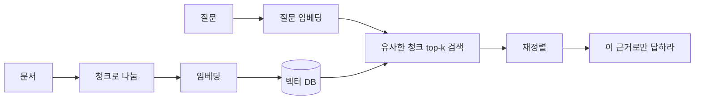

SK하이닉스 AI 해커톤 1차 예선을 봤습니다. 우리가 일반적으로 AI 에이전트나 도구를 사용해서 여러가지 프롬프트를 구성하고, 다양한 작업을 수행하는데요, 그 내부에는 AI 시스템과 활용에 대하여 인지하고 있으면 유익한 개념들이 있습니다. 해커톤이 아니어도 AI로 무언가를 만드는 사람이라면 한 번쯤 짚고 갈 만한 것들이었습니다. 그래서 블로그에 옮겨둡니다.

예시에 웨이퍼나 설비 이야기가 섞여 있는 건 시험 맥락 때문이고, 개념은 어느 도메인이든 같습니다.

## 문제를 푸는 순서

AI에게 어떤 작업을 요청할 때 '이거 ~해줘' 이런 식으로 하는 것보다 당연히 구체적인 요청을 할수록 그 정확도 높아지겠지요?
**정답보다 생각의 순서**가 중요합니다.

| 단계 | 할 일 | 자주 빠지는 것 |
| --- | --- | --- |
| 1. 문제 정의 | 현상과 진짜 목표를 구분합니다. "누가, 무엇 때문에, 무엇이 안 되는가" | 해결책("챗봇 만들자")부터 정함 |
| 2. 성공 기준 | 숫자로 둡니다 (Recall 90%, 처리 시간 절반) | 기준이 없어 결과를 판단할 수 없음 |
| 3. 데이터·제약 | 데이터, 라벨 유무, 보안·비용·시간 | 기밀 데이터를 외부 AI에 입력 |
| 4. 방법 선택·실행 | 프롬프트 / RAG / Agent / ML / 단순 규칙 중 맞는 것 | 가장 화려한 도구를 고름. 단순한 방법이 충분할 때가 많음 |
| 5. 검증·개선 | 기준 대비 확인, 실패 사례 분석, 고쳐서 반복 | AI 결과를 검증 없이 제출 |

이 순서를 지키려면 몇 가지 습관이 필요합니다.

- AI에 한 번에 다 시키지 않고 **쪼개서** 시킵니다 (조사 → 초안 → 검토)
- 결과는 **근거와 테스트로 검증**하고, 틀린 곳을 고칩니다
- 요약·초안·코드는 AI가, 목표 설정·최종 판단·책임은 사람이 맡습니다
- 왜 이 방법을 골랐고 다른 건 왜 버렸는지 **한 줄로** 설명할 수 있어야 합니다 (공유 협업)

## LLM

| 용어 | 정의와 짚을 점 |
| --- | --- |
| LLM | 대량의 텍스트로 **다음 토큰 예측**을 학습한 트랜스포머 모델. 사실을 찾아오는 검색기가 아니라서 할루시네이션이 구조적으로 생깁니다 |
| 토큰 | 텍스트를 처리하는 단위(단어 조각). 비용과 길이 제한의 단위이고, 한국어는 영어보다 토큰이 많이 듭니다 |
| 컨텍스트 윈도우 | 한 번에 처리하는 입력+출력 토큰의 최대치. 넘치면 잘리거나 거부됩니다. 길수록 **중간 내용을 놓치는 현상(lost in the middle)** 이 생기고 비용·지연도 늘어서, 크다고 무조건 좋은 게 아닙니다 |
| 파라미터 | 학습으로 정해지는 내부 숫자. "70B"는 700억 개입니다 |
| 추론 (inference) | 학습된 모델로 답을 내는 과정. 학습(training)과 구분합니다 |
| Temperature | 무작위성을 조절합니다. 0이면 답이 일관되지만 **정확도를 보장하지는 않습니다.** 틀린 답도 일관되게 냅니다 |
| Top-p / Top-k | 후보 토큰을 누적 확률 p 이내, 또는 상위 k개로 제한합니다 |
| 할루시네이션 | 근거 없이 그럴듯한 거짓. 지식이 부족하거나, 학습 시점 이후 정보이거나, 질문이 모호할 때 생깁니다 |
| Knowledge cutoff | 학습 데이터의 마지막 시점. 이후 일은 모르므로 검색이나 RAG로 보완합니다 |
| 시스템 프롬프트 | 역할과 규칙을 정하는 상위 지시. 사용자 입력보다 우선합니다 |
| 멀티모달 | 텍스트·이미지·음성을 함께 이해하고 생성합니다 |
| 추론 모델 | 답하기 전에 긴 사고 과정을 생성하도록 강화학습된 LLM(test-time compute). 수학·코딩·계획·원인 분석에 강하지만 느리고 비쌉니다. CoT를 지시하기보다 목표와 조건을 명확히 주는 편이 낫고, **오래 생각해도 모르는 지식이 생기지는 않습니다** |

할루시네이션을 줄이는 방법은 네 가지로 정리됩니다.

1. 근거를 주고 그 안에서만 답하게 합니다 (RAG)
2. 출처를 달게 하고 대조합니다
3. 모르면 "모른다"고 답하게 합니다
4. 계산이나 조회는 도구에 맡깁니다

개념적인 문제에서 자주 보이는 오답으로는 "temperature를 0으로 낮춘다", "더 큰 모델로 바꾼다"였습니다. 둘 다 근본적인 해결이 아닙니다.

## 프롬프트

좋은 프롬프트에는 **목표, 입력 데이터, 제약, 출력 형식, 검증 기준** 다섯 가지가 들어갑니다. 이 중 가장 자주 빠지는 게 검증 기준입니다.

| 기법 | 언제 쓰고, 무엇을 조심하나 |
| --- | --- |
| Zero-shot | 예시 없이 지시만. 단순한 작업에 씁니다 |
| Few-shot | 예시 2~5개. 형식이나 판단 기준을 맞출 때 씁니다. 예시가 치우치면 결과도 치우치고 토큰이 늘어납니다 |
| In-context learning | 가중치를 바꾸지 않고 프롬프트 속 예시만으로 작업을 익히는 능력. few-shot이 통하는 이유입니다 |
| Chain-of-Thought | 단계별로 추론하게 합니다. 계산·다단계 논리에 유리하지만 비용·지연이 늘고, 단순 분류에서는 이득이 작습니다 |
| 역할 부여 | 톤과 관점을 정합니다. 없는 지식을 만들어내지는 않습니다 |
| 구분자 | 지시와 데이터를 태그나 ` ``` `로 나눕니다. 데이터를 지시로 오해하는 걸 막아 인젝션 방어도 됩니다 |
| 구조화된 출력 | JSON 스키마를 지정해 후처리 오류를 줄입니다 |

결과가 이상하면 이 순서로 의심합니다. **지시가 모호한가 → 정보가 부족한가 → 형식을 안 정했나 → 예시가 치우쳤나.** 그래도 안 될 때 모델이나 도구를 바꿉니다.

`이 데이터 분석해줘`를 고쳐 쓰면 이렇게 됩니다.

```text
[역할·목표] 공정 데이터 분석가로서, 지난 4주 설비별 센서 데이터에서 불량률이 갑자기 오른 원인 후보를 찾아줘.
[입력] 아래 CSV (컬럼: date, equipment, temp, pressure, is_defect)
[제약] 데이터에 없는 값은 추측하지 말고 "데이터 없음". 상관과 인과를 구분해.
[형식] 원인 후보 3개를 표로: 후보 / 근거 수치 / 확신도(상·중·하) / 추가로 확인할 데이터
[검증] 각 후보의 근거가 된 행 범위나 집계값을 함께 적어.
```

원래 프롬프트는 목표·형식·검증 기준이 빠져 있어서 결과가 매번 다르고 맞는지 확인할 방법도 없습니다. 고친 버전은 역할과 목표를 밝히고, 데이터를 구분하고, 추측을 막고, 형식을 고정했습니다. 마지막 줄 덕분에 **답이 맞는지 사람이 확인할 수 있게** 됩니다.

## RAG

RAG는 질문과 관련된 문서를 찾아 근거로 붙여주는 방식입니다.



RAG 답이 틀리면 **모델보다 검색부터** 봅니다.

1. 문서가 등록돼 있는가
2. 최신 버전인가
3. 검색된 청크가 질문과 관련 있는가
4. 답이 근거와 맞는가

| 용어 | 정의와 짚을 점 |
| --- | --- |
| 임베딩 | 의미를 담은 숫자 벡터. 의미가 비슷하면 가깝습니다 |
| 코사인 유사도 | 두 벡터의 **방향**이 같은 정도(-1~1). 1에 가까울수록 비슷합니다 |
| 벡터 DB | 임베딩을 저장하고 비슷한 벡터를 찾아줍니다 |
| 청킹 / overlap | 문서를 조각으로 나눕니다. 크면 잡음이 섞이고 작으면 문맥이 끊깁니다. overlap은 경계에서 문맥이 끊기는 걸 막습니다 |
| Top-k | 가져올 조각 수. 크면 잡음, 작으면 누락 |
| BM25 | 키워드 일치 검색. **품번·장비 코드·고유명사에 강합니다** |
| 하이브리드 검색 | BM25와 벡터 검색을 함께 씁니다 |
| 재정렬 (reranker) | 1차 검색 결과를 관련도 순으로 다시 세웁니다 |
| 메타데이터 필터 | 날짜·부서 등으로 범위를 좁혀 구버전이 섞이는 걸 막습니다 |
| Faithfulness | 답이 검색된 근거와 일치하는 정도 |
| 지식 그래프 | 개체와 관계를 그래프로 저장합니다. 관계를 묻는 질의에 강합니다 |

RAG와 파인튜닝은 자주 비교되지만 바꾸는 대상부터 다릅니다.

| | RAG | 파인튜닝 |
| --- | --- | --- |
| 바꾸는 것 | 넣어주는 자료 | 모델 가중치 |
| 적합한 경우 | 자주 바뀌는 지식, 출처가 필요할 때, 사내 문서 | 말투·형식·작업 방식을 고정할 때 |
| 최신화 / 비용 | 문서만 교체 / 낮음 | 재학습 / 높음 |

**"지식"이 문제면 RAG, "행동 방식"이 문제면 파인튜닝이나 프롬프트**입니다. 기준이 명확하고 예외가 적으면 규칙 기반이 가장 싸고 정확합니다.

## Agent와 MCP

챗봇은 답을 말하고, **Agent는 도구를 호출해서 실행합니다.** 목표 → 행동 결정 → 도구 호출 → 결과 관찰을 반복하는 구조(ReAct)이고, 핵심 질문은 "어디까지 하게 두고 어떻게 통제하나"입니다.

| 설계 포인트 | 확인할 것 |
| --- | --- |
| 도구 선택 | 이름·설명·입력 형식이 명확해야 잘 고릅니다. 너무 많으면 헷갈립니다 |
| 권한 | **최소 권한.** 읽기와 쓰기·삭제를 나눕니다 |
| 실패 처리 | 재시도 횟수 제한, 타임아웃, 에러를 모델에 돌려주기, 무한 반복 방지. 계속 실패하면 멈추고 보고합니다 |
| 사람 승인 | 결제·삭제·발송·배포처럼 되돌리기 어려운 작업은 실행 전에 승인을 받습니다 (human-in-the-loop) |
| 기록 | 어떤 도구를 왜 불렀는지 로그로 남깁니다 |

| 용어 | 정의와 짚을 점 |
| --- | --- |
| Function calling | 모델이 "어떤 도구를 어떤 인자로" 부를지 구조화해서 출력합니다. **실제 실행은 앱(개발자 코드)이 합니다.** 그래서 앱에서 권한 확인이나 승인을 끼워 넣을 수 있습니다 |
| MCP | AI 앱과 도구·데이터 서버를 잇는 표준 프로토콜(Anthropic, 2024.11). 도구를 서버로 한 번 만들면 여러 앱에서 재사용합니다 (N×M → N+M) |
| MCP 구성 | 호스트(AI 앱) · 클라이언트(서버마다 1개) · 서버(도구 제공). 서버는 Tools·Resources·Prompts를 제공하고, 로컬은 stdio, 원격은 HTTP로 붙습니다 |
| Function calling vs MCP | 모델↔앱 사이의 형식과 앱↔도구 서버 사이의 규약입니다. **경쟁 관계가 아니라 함께 씁니다** |
| A2A | Agent끼리 통신하는 프로토콜. MCP는 Agent와 도구 사이입니다 |
| 멀티 에이전트 | 역할별 Agent가 나눠 일합니다. 대신 조율 비용이 늘어납니다 |
| 코딩 에이전트 | 코드를 읽고 고치고 테스트·명령을 실행합니다. 결과는 테스트와 리뷰로 검증합니다 |
| 바이브 코딩 | 자연어로 지시하고 결과를 실행해보며 개발합니다. 프로토타입은 빠르지만 보안과 품질은 사람이 봐야 합니다 |
| 컨텍스트 엔지니어링 | 어떤 정보를 언제, 얼마나 넣을지 설계합니다. 문구보다 넣는 정보가 결과를 좌우합니다 |

MCP를 쓸 때 조심할 점도 있습니다.

- 서버가 돌려준 내용 속에 지시가 숨어 있을 수 있습니다(인젝션). 결과는 데이터로만 다룹니다
- 서버에 준 토큰이 곧 Agent의 권한입니다. 읽기 전용, 최소 권한으로 줍니다
- 모르는 서버를 설치하는 건 남의 코드를 실행하는 것과 같습니다
- 연결한 도구의 설명이 요청마다 토큰을 차지합니다. 필요한 서버만 붙입니다

## 평가 지표

|  | 실제 양성 | 실제 음성 |
| --- | --- | --- |
| **예측 양성** | TP | FP (오탐, 1종 오류) |
| **예측 음성** | FN (미탐, 2종 오류) | TN |

```text
Precision = TP / (TP + FP)
Recall    = TP / (TP + FN)
F1        = 2 × Precision × Recall / (Precision + Recall)
```

| 지표 | 언제 보나 |
| --- | --- |
| Accuracy | 데이터가 균형 잡혔을 때만. 불량률이 1%면 "전부 양품"이라고만 해도 99%가 나옵니다 |
| Precision | 오탐 비용이 클 때 (정상품 폐기, 중요한 메일이 스팸함으로) |
| Recall | 놓치면 큰일일 때 (불량 유출, 암 진단, 사기) |
| F1 | 둘 다 중요하고 데이터가 불균형할 때. 조화평균이라 한쪽이 낮으면 크게 깎입니다 |
| ROC-AUC / PR-AUC | 임계값 전체에 걸친 성능. 0.5는 무작위 수준이고, 불균형이 심하면 PR-AUC를 봅니다 |
| MAE / RMSE | 회귀 오차. RMSE가 큰 오차에 더 민감합니다 |

-**임계값(threshold): 합격과 불합격, 경고 여부를 가르는 기준선 숫자입니다.""
- **임계값을 낮추면 Recall은 오르고 Precision은 내려갑니다.** 재학습 없이 놓치는 불량을 줄이려면 임계값을 낮춥니다
- **데이터 분할:** Train(학습) / Validation(튜닝) / Test(마지막에 한 번만). 데이터가 적으면 k-fold 교차 검증을 씁니다
- **과적합:** 학습 성능은 높은데 검증이 낮은 상태. 데이터를 늘리거나 증강하고, 정규화(L1/L2)·드롭아웃·조기 종료·모델 단순화를 시도합니다. 둘 다 낮으면 과소적합이라 반대로 모델을 키우거나 특징을 더합니다
- **데이터 누수:** 테스트 데이터나 미래 정보가 학습에 섞인 경우입니다. 시계열을 무작위로 나누거나, 결과가 나온 뒤에야 아는 변수를 넣거나, 전체를 정규화한 뒤 분할하면 생깁니다. **성능이 너무 좋으면 누수부터 의심**하고 시간순으로 다시 나눕니다
- **불균형:** 층화 분할, 가중치, 오버/언더샘플링을 쓰고, F1이나 PR-AUC로 평가합니다
- **LLM 평가:** 골든셋(기준 질문과 모범 답안)으로 회귀 테스트를 돌리고, 사람 평가와 LLM-as-a-judge를 함께 씁니다(채점 모델의 편향은 조심). RAG는 검색 정확도와 faithfulness를 따로 봅니다. 벤치마크 점수가 내 업무에서의 성능은 아닙니다

## 머신러닝·딥러닝 기초

| 구분 | 핵심 | 예시 |
| --- | --- | --- |
| 지도학습 | 라벨 있음. 분류(범주) / 회귀(숫자) | 불량 분류, 수율 예측 |
| 비지도학습 | 라벨 없음. 군집, 차원 축소, 이상 탐지 | 센서 이상 탐지 |
| 강화학습 | 행동에 대한 보상으로 정책을 학습 | 공정 제어, RLHF |
| 자기지도학습 | 데이터 스스로 문제를 만듦 | LLM 사전학습 |

- **손실 함수**는 오차를 숫자로 만든 것입니다(회귀는 MSE, 분류는 교차 엔트로피). **경사하강법**은 손실이 줄어드는 방향으로 조금씩 고쳐갑니다. 학습률이 크면 발산하고 작으면 느립니다
- **에폭**은 데이터 전체를 한 번 도는 것, **배치**는 한 번에 넣는 묶음입니다. **하이퍼파라미터**는 학습률이나 층 수처럼 사람이 정하는 값이고, **특징**은 입력 변수입니다
- **데이터 증강**은 회전·반전·밝기 조절로 데이터를 늘리는 것이고, **전이학습**은 사전학습된 모델을 내 작업에 맞게 조정하는 것입니다. 데이터가 적을 때 씁니다
- **CNN**은 이미지의 국소 패턴을 잡아 결함 이미지 분류에 쓰입니다. **트랜스포머**는 어텐션으로 모든 위치가 서로를 얼마나 참고할지 계산하고(Query·Key·Value), 병렬 처리가 됩니다
- **LLM을 만드는 순서**는 사전학습 → SFT(지시 따르기) → RLHF/DPO(선호 정렬)이고, 필요하면 LoRA처럼 일부만 파인튜닝합니다
- **생성형 모델**에는 LLM(텍스트), 디퓨전(노이즈를 걷어내며 이미지 생성), 멀티모달, 임베딩 모델이 있습니다

## 신뢰와 보안

결과를 검증할 때는 세 가지를 차례로 봅니다. **근거와 일치하는가 → 조건과 제약을 지켰는가 → 예외 입력(경계값·빈 입력·이상치)에서도 맞는가.**

| 위험 | 대응 |
| --- | --- |
| 프롬프트 인젝션 (입력이나 문서에 숨긴 지시) | 지시와 데이터 분리, 외부 내용은 데이터로만 처리, 권한 최소화, 위험한 작업은 사람 승인, 가드레일 |
| 탈옥 (안전 규칙 우회) | 입출력 필터(가드레일) |
| 정보 유출 (기밀을 외부 AI에 입력해 로그·학습에 남음) | 사내(온프레미스) 모델, 미보관·미학습 계약, 마스킹·비식별화, 사용 규정 |
| 데이터 편향 | 데이터 점검, 그룹별 성능 확인 |
| 저작권 | 출처 확인, 사내 규정 |
| 과신 (automation bias) | 신뢰도 표시, 중요한 결정은 사람이 최종 확인 |

- **XAI**는 판단 근거를 보여줍니다(SHAP, Grad-CAM). 현장에서 받아들여지는지, 책임을 누가 지는지와 연결됩니다
- **규제**는 한국 AI 기본법(2026년 1월 시행)과 EU AI Act가 있습니다. 위험도가 높을수록 설명·기록·사람의 감독을 요구한다는 방향만 알아두면 됩니다

## 모델 선택·운영·비용

| 상황 | 판단 |
| --- | --- |
| 단순 분류·추출을 대량으로 | 작은 모델이나 전통 ML. 큰 LLM은 낭비입니다 |
| 복잡한 추론, 낮은 빈도 | 큰 모델이나 추론 모델 |
| 외부 반출이 안 되는 데이터 | 온프레미스, 오픈 모델을 자체 서버에 |
| 실시간 (설비 제어, 라인 판정) | 경량 모델, 엣지 배포 |
| 정답이 정해진 계산·조회 | LLM 말고 코드나 DB 도구 |

비용과 속도는 **덜 보내기 → 덜 받기 → 다시 쓰기 → 싼 모델** 순서로 줄입니다.

- 필요한 부분만 넣습니다(RAG). 긴 대화는 요약하고 다 쓴 도구 결과는 지웁니다
- 출력 길이를 제한합니다. **출력 토큰이 입력보다 비싸서** 효과가 큽니다
- **프롬프트 캐싱**은 반복되는 앞부분을 재사용합니다. 글자 하나까지 같아야 적중하므로 고정된 내용은 앞에, 질문은 뒤에 둡니다. 몇 분 단위로 만료됩니다
- 쉬운 요청은 작은 모델로 보내고(라우팅), 늦어도 되면 배치 API로 할인을 받고, 쉬운 문제에서는 추론 토큰을 줄입니다
- 양자화(정밀도를 낮춰 경량화, 약간의 성능 손실)나 지식 증류(큰 모델을 흉내 내는 작은 모델)도 있습니다
- 무엇보다 **측정이 먼저**입니다. 요청마다 입력·출력·캐시 토큰을 기록합니다

운영(MLOps/LLMOps)에서는 드리프트를 봅니다. 입력 분포가 바뀌면 성능이 **조용히** 떨어집니다. 
오류율·비용·지연을 모니터링하고, 재학습하고, 모델과 프롬프트를 버전으로 관리하고, 바꿀 때마다 골든셋으로 회귀 테스트를 돌립니다.
(골든셋(golden set)은 정답이 이미 확인된 입력과 기대 결과를 모아 둔 고정된 테스트 데이터 묶음입니다.)

## 상황별로 먼저 확인할 것

시험을 준비하며 가장 많이 본 표입니다. 오답 보기는 대부분 "모델을 바꾼다", "더 큰 모델을 쓴다"였습니다.
이건 특정 시험이 아니더라도 우리가 특정 환경에서 이런 부분을 조정했을 때, AI가 다시 올바른 답을 도출해 낼 수 있을 것으로 기대되므로 한번 씩 읽어보시면 좋을 것 같습니다.

| 상황 | 먼저 확인 | 해법 |
| --- | --- | --- |
| 사실과 다른 답을 자신 있게 함 | 근거를 줬나, 학습 시점 이후 정보인가 | RAG, 출처 표시, 모르면 모른다고 |
| 사내 문서 챗봇이 엉뚱한 답을 함 | 문서 등록·최신성 → 검색 결과 → 답과 근거 일치 | 청크 조정, 하이브리드 검색, 재정렬 |
| 품번·장비 코드로 검색하면 못 찾음 | 벡터 검색만 쓰나 | BM25 병행 |
| Accuracy 99%인데 불량을 놓침 | 클래스 비율, Recall | Recall·F1로 평가, 임계값 낮춤, 불균형 처리 |
| 오탐이 많아 현장에서 경보를 무시함 | Precision | 임계값 올림, 특징 개선 |
| 검증은 좋았는데 배포 후 급락 | 누수, 드리프트, 운영 환경의 전처리 차이 | 시간순 재검증, 모니터링, 재학습 |
| 학습 성능은 높고 검증은 낮음 | 과적합 | 데이터 추가, 정규화, 단순화 |
| 결함 이미지가 너무 적음 | 클래스 비율 | 증강, 오버샘플링·가중치, 전이학습, 이상 탐지. Recall·PR-AUC로 평가 |
| 라벨이 거의 없는 설비 이상 감지 | 라벨 유무 | 비지도 이상 탐지(오토인코더, Isolation Forest) → 능동 학습 |
| Agent의 도구 호출이 계속 실패 | 도구 설명·입력 형식, 권한, 에러 반환 | 재시도·타임아웃 제한, 멈추고 보고 |
| Agent가 삭제·발송을 함부로 함 | 권한 범위 | 최소 권한, 사람 승인 |
| 문서 속 숨은 지시로 답이 조작됨 | 프롬프트 인젝션 | 지시와 데이터 분리 |
| 같은 질문에 매번 다른 답 | temperature, 프롬프트의 모호함 | temperature 낮춤, 형식·예시 지정 (정확도는 별개) |
| 긴 문서를 넣었더니 중간을 놓침 | 컨텍스트 길이 | 필요한 부분만 검색, 나눠서 요약 |
| 직원이 기밀을 외부 챗봇에 입력함 | 보관·학습 정책 | 사내 모델, 마스킹, 사용 규정 |
| LLM 비용이 너무 큼 | 모든 요청에 큰 모델을 쓰나 | 라우팅, 캐싱, 출력 제한 |
| MCP 서버 10개를 붙였더니 느리고 비쌈 | 도구 설명이 요청마다 토큰을 차지 | 필요한 서버만, 캐싱, 토큰 기록 |
| 보고서를 AI로 자동 작성하려 함 | 기밀 등급, 근거 검증, 책임자 | 자동 작성 → 사람 검토 → 발행, 형식 고정 |
