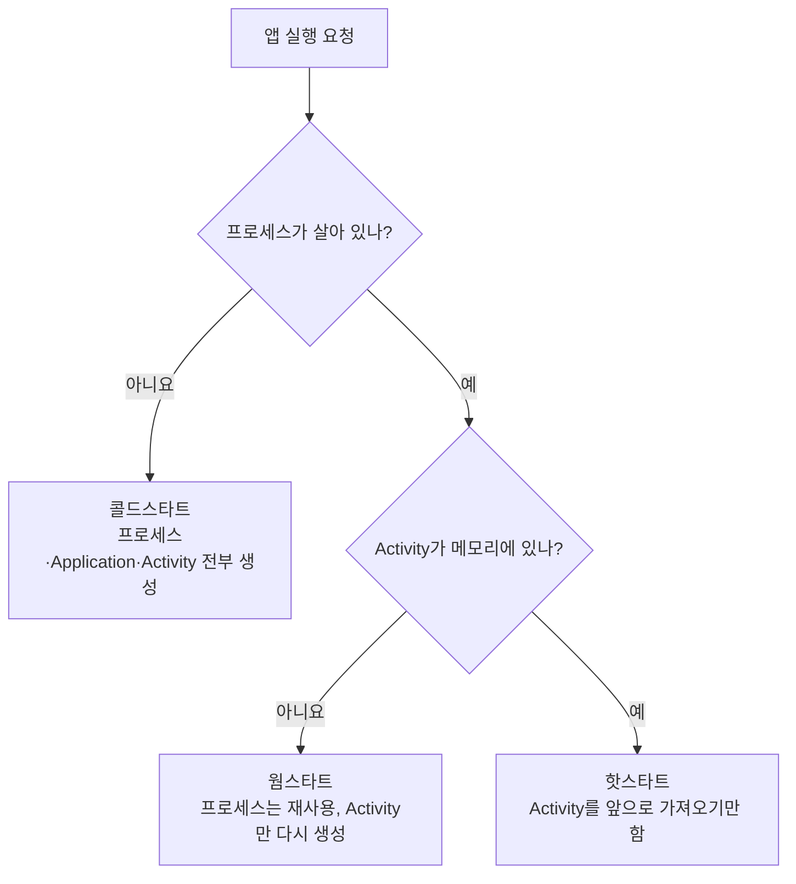
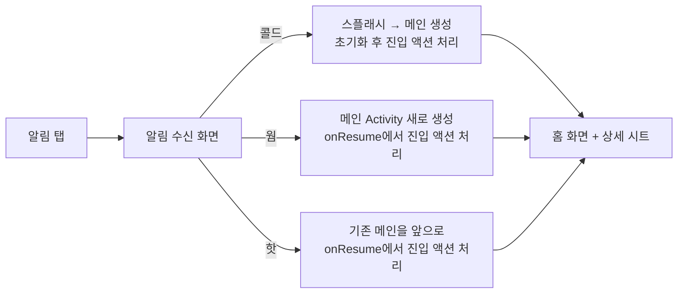

앱이 어떤 상태였든 알림을 누르면 같은 화면으로 보내야 하는 기능은 흔합니다. 이런 기능을 빠짐없이 테스트하려면 앱이 시작되는 상태부터 정확히 나눠 봐야 해서 정리해 봤습니다.

## 세 가지 시작 상태

Android 공식 문서(App startup time)는 앱 시작을 프로세스와 Activity가 메모리에 남아 있는지로 나눕니다.



| 구분 | 프로세스 | Activity | 흔한 상황 |
|---|---|---|---|
| 콜드스타트 | 없음 → 새로 생성 | 새로 생성 | 재부팅 후 첫 실행, 최근 앱에서 지운 뒤 실행, 시스템이 프로세스를 정리한 뒤 |
| 웜스타트 | 살아 있음 | 다시 생성 | 뒤로가기로 Activity를 끝낸 뒤 다시 실행, 메모리가 부족해 Activity만 정리된 경우 |
| 핫스타트 | 살아 있음 | 살아 있음 | 홈 버튼으로 나갔다가 다시 들어옴 |

비용은 콜드 > 웜 > 핫 순서입니다. 웜스타트는 `Application.onCreate()`를 건너뛰지만 Activity는 `onCreate()`부터 다시 거칩니다. 핫스타트는 `onRestart()`부터 `onResume()`까지만 탑니다.

## 직접 확인하는 방법

`adb shell am start -W`로 앱을 띄우면 결과에 `LaunchState`가 찍힙니다. 세 상태를 이렇게 재현할 수 있습니다.

```bash
# 콜드: 프로세스를 죽인 뒤 실행
adb shell am force-stop <package>
adb shell am start -W -n <package>/<launcher-activity>

# 웜: 앱 화면에서 뒤로가기로 Activity를 끝낸 뒤 실행
adb shell am start -W -n <package>/<launcher-activity>

# 핫: 홈 버튼으로 나간 뒤 실행
adb shell input keyevent KEYCODE_HOME
adb shell am start -W -n <package>/<launcher-activity>
```

출력에서 `LaunchState: COLD`/`WARM`/`HOT`과 `TotalTime`을 함께 보면 상태별 시작 시간도 비교할 수 있습니다.

## 알림 진입 처리에서 달라지는 점

"앱이 어떤 상태든 같은 화면으로 보내라"는 기능은 세 상태에서 코드가 지나는 길이 다릅니다.



여기서 신경 쓸 점은 두 가지입니다.

- **"메인이 떠 있는지"를 정적 참조로 판단하면 웜스타트를 놓칩니다.** Activity 인스턴스를 companion object 같은 곳에 들고 있다가 해제하지 않는 코드가 꽤 있습니다. 웜스타트에서는 프로세스가 살아 있으니 이 참조도 남아 있지만 가리키는 Activity는 이미 종료된 상태입니다. 그래서 "참조가 있으면 바로 메서드 호출" 같은 분기는 위험합니다. 인텐트를 보내서 Activity가 새로 만들어지든 재사용되든 `onResume`에서 처리하도록 하는 편이 안전합니다.
- **전달할 데이터는 진입 경로와 상관없이 같은 곳에 둡니다.** 예를 들어 "어떤 항목을 열지"를 대기 변수에 넣어 두고, 메인이 `onResume`이든 초기화 직후든 같은 함수로 꺼내 쓰게 합니다. 경로가 셋이어도 처리 함수는 하나라서 상태마다 따로 고칠 일이 없습니다.

## 마치며

"어떤 상태에서 눌러도 같은 화면"이라는 기능은 단순해 보여도, 홈 버튼으로 나간 경우만 테스트하면 뒤로가기로 닫은 경우(웜스타트)를 놓치기 쉽습니다. 앱 진입과 관련된 기능을 만들 때는 콜드, 웜, 핫 세 가지를 따로 재현해 보는 것을 체크리스트에 넣어 두려고 합니다.

- 참고: [App startup time | Android Developers](https://developer.android.com/topic/performance/vitals/launch-time)
