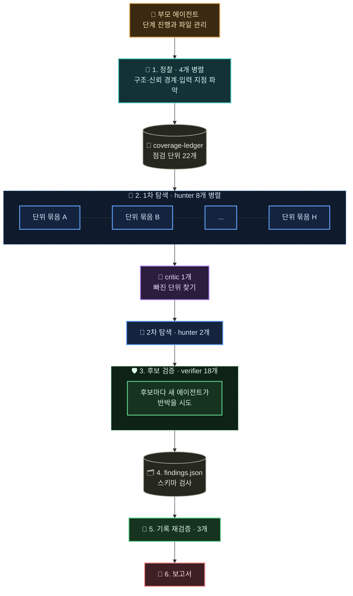
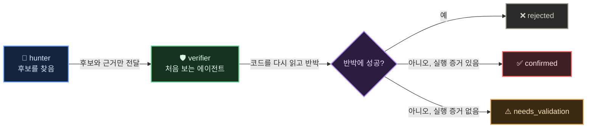
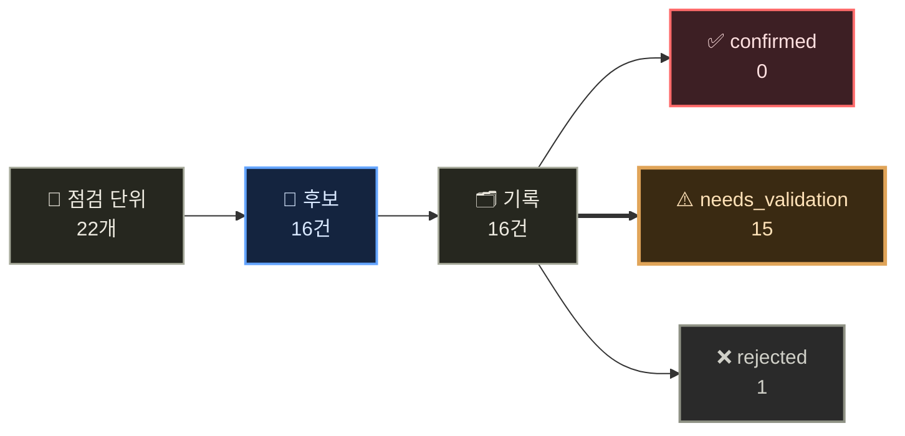

Cloudflare가 공개한 [security-audit-skill](https://github.com/cloudflare/security-audit-skill)을 설치해 봤습니다. 코딩 에이전트에 붙이면 에이전트가 보안 감사를 하도록 만드는 스킬입니다. Cloudflare가 [Build your own vulnerability harness](https://blog.cloudflare.com/build-your-own-vulnerability-harness)에서 소개한 취약점 탐지 하네스가 이 스킬에서 시작됐고 저장소에 올라온 건 그 하네스의 단일 저장소용 출발점입니다.

## 여섯 단계

감사는 여섯 단계로 진행됩니다.

1. **정찰**: 아키텍처, 신뢰 경계, 입력 지점을 정리해 `architecture.md`와 `coverage-ledger.json`을 만듭니다.
2. **커버리지 기반 탐색**: ledger의 단위마다 서로 격리된 hunter 에이전트를 붙이고 빠진 곳은 critic 에이전트가 찾습니다.
3. **후보 검증**: 찾은 후보를 새 verifier 에이전트에게 넘겨 반박해 보게 합니다.
4. **구조화 출력**: 결과를 `confirmed`, `needs_validation`, `rejected`로 나눠 `findings.json`에 쓰고 스키마로 검사합니다.
5. **독립 재검증**: 최종 기록의 근거를 또 다른 에이전트가 다시 확인합니다.
6. **보고서**: 검증된 기록만으로 `REPORT.md` 같은 문서를 만듭니다.

## 눈에 띈 원칙

README의 설계 원칙 중 몇 개가 마음에 들었습니다.

- 찾은 에이전트와 검증하는 에이전트가 절대 같지 않습니다.
- 심각도는 체크리스트 위반이 아니라 발생 가능성과 영향으로 매깁니다.
- 앞단에서 이미 막히는 공격이라면 뒷단 방어가 없어도 취약점이 아니라 hardening 메모로 남깁니다.
- 대상 코드를 실행하려면 네트워크가 막힌 OS 수준 샌드박스가 있어야 하고 없으면 실행하지 않고 `needs_validation`으로 둡니다.
- 한 번 돌리면 반복 실행으로 찾은 전체 취약점의 절반 정도만 나왔다고 합니다. 그래서 실행 결과가 누적되도록 설계했습니다.

AI가 그럴듯한 취약점을 만들어내는 문제를 구조로 막으려는 게 보입니다. 확신이 없는 건 확신이 없다고 남기게 되어 있습니다.

## 모바일 앱에 쓸 만한가

공격 유형 문서가 영역별로 나뉘어 있는데, 그중 `DESKTOP-MOBILE-AND-LOCAL-IPC.md`가 딥링크, WebView, exported 컴포넌트 같은 Android 앱의 주요 공격면을 다룹니다. 서명이나 릴리스 설정은 `SUPPLY-CHAIN-AND-RELEASE.md`에서 봅니다. 모바일 앱에도 바로 쓸 수 있는 범위입니다.

다만 전체 감사는 에이전트를 여러 개 병렬로 띄우는 구조라 토큰을 많이 씁니다. 그래서 저는 매번 돌리지 않기로 했습니다. 딥링크나 App Link 처리, 토큰, 결제, 서명 설정처럼 보안 경계에 닿는 작업을 했을 때만 에이전트가 범위를 좁힌 감사를 제안하게 하고 실행은 제가 승인할 때만 합니다.

설치는 한 줄입니다.

```bash
npx skills add https://github.com/cloudflare/security-audit-skill \
  --skill security-audit \
  --global
```

## 실제로 돌려 봤습니다

설치하고 며칠 뒤 회사 Android 앱 저장소 전체를 대상으로 standard 프로필 감사를 한 번 끝까지 돌렸습니다. 아래 내용은 회사 코드와 인프라가 드러나지 않도록 파일 이름, 서비스 이름, 아직 확인 중인 항목의 세부 내용은 빼고 구조와 숫자 위주로 적었습니다.

### 에이전트가 일하는 방식

감사는 부모 에이전트 하나가 단계마다 하위 에이전트를 띄우고 결과 파일만 모으는 방식으로 진행됩니다. 하위 에이전트끼리는 대화하지 않고 서로의 판단을 보지 못합니다.



정찰 에이전트 4개가 앱 구조와 신뢰 경계, 입력 지점을 파악하고 그 결과로 점검 단위 22개짜리 장부(ledger)를 만듭니다. hunter 8개가 이 장부를 나눠 맡아 동시에 탐색하고 critic이 장부에서 아무도 깊게 보지 않은 곳을 찾아 2차 hunter에게 넘깁니다. 이번 실행에는 모두 36개 에이전트가 들어갔습니다.

가장 중요하게 본 건 찾는 쪽과 검증하는 쪽을 나누는 구조입니다.



hunter는 자기가 찾은 걸 취약점이라고 믿고 싶어합니다. 그래서 검증은 그 대화를 전혀 모르는 새 에이전트가 맡고 이 에이전트의 일은 후보를 무너뜨리는 것입니다. 무너뜨리지 못해도 실제로 실행해서 재현한 증거가 없으면 confirmed로 올라가지 않습니다.

### 결과



confirmed가 0건인 건 취약점이 없다는 뜻이 아닙니다. 빌드나 에뮬레이터를 네트워크가 막힌 샌드박스에서 돌릴 수 없는 환경이라 대상 코드를 하나도 실행하지 않았고 규칙상 실행 증거가 없으면 확정하지 않습니다. 대신 needs_validation 기록마다 "확정을 막는 사실"과 "소유자가 확인할 것"이 붙어 나옵니다. 사람이 무엇을 확인하면 되는지까지 정리해 주는 셈입니다.

15건을 성격별로 묶으면 이렇습니다.

| 분류 | 건수 | 어떤 문제인가 |
|---|---|---|
| 외부에 열린 진입점 | 4 | 다른 앱이나 링크가 호출할 수 있는 화면·리시버가 호출자를 확인하지 않고 내부 동작을 수행 |
| 민감 정보 노출 경로 | 3 | 오류 리포트나 URL에 인증 정보가 그대로 실림 |
| WebView·인텐트 처리 | 2 | 웹 페이지가 앱 내부 화면이나 로컬 파일에 닿을 수 있는 경로 |
| 인프라·비밀 관리 | 2 | 배포 환경의 권한 설정과 비밀 값 관리 |
| 파일 경로 처리 | 2 | 서버에서 받은 이름으로 파일을 쓸 때 경로 검사가 없음 |
| 네트워크 | 1 | 인증 헤더가 API 서버가 아닌 곳으로 갈 수 있는 재시도 경로 |
| 알림 처리 | 1 | 알림끼리 식별 값이 겹쳐 이전 알림의 동작이 최신 알림에 적용될 수 있음 |

기각된 1건은 verifier가 실제 영향이 성립하지 않는다는 걸 코드로 보여서 빠졌습니다. 취약점은 아니어도 고쳐 두면 좋은 하드닝 메모와, 이미 잘 되어 있는 부분(백업 제외 규칙, 로그아웃 시 토큰 정리, 결제 서버 검증 등)도 따로 정리돼 나왔습니다.

### 사람이 한 일

보고서가 나온 뒤에는 제가 항목별로 판단했습니다.

- 인프라 권한 설정 건은 백엔드 담당자에게 확인을 요청했고 실제 배포 설정에는 문제가 없다는 답을 받았습니다.
- 비밀 관리 건은 저장소 접근 범위를 기준으로 판단해 이번에는 조치 대상에서 뺐습니다.
- 오류 리포트에 인증 정보가 실리던 건은 바로 고쳤습니다. 리포트로 보내기 전에 민감한 키의 값을 가리고 release 빌드에서 HTTP 본문 로그가 남지 않도록 막았습니다.
- 나머지는 needs_validation에 적힌 확인 방법대로 하나씩 볼 목록으로 남겨 두었습니다.

에이전트가 "취약점이다"라고 단정하지 않고 "이걸 확인하면 확정된다"로 넘겨주니, 판단을 사람이 하는 흐름이 자연스러웠습니다.

### 비용과 타협

에이전트 36개를 쓰니 토큰을 정말 많이 썼습니다. 중간에 사용량이 한도에 가까워져서 두 가지를 줄였습니다.

- 기록 재검증을 기록마다 에이전트 1개씩이 아니라, 3개가 5건씩 묶어서 했습니다.
- 2차 탐색 뒤의 critic과 마지막 클린 critic을 돌리지 않았습니다.

스킬은 이런 타협을 숨기지 않습니다. 실행 기록에 `run_status: incomplete`와 줄인 단계가 그대로 남고, 보고서에도 "커버리지가 빠짐없다고 주장하지 않는다"고 적힙니다. 다음 실행은 이번 기록을 이어받아 빠진 단계부터 채울 수 있습니다.

### 하나 조심할 점

감사 도중 하위 에이전트 둘의 도구 출력에 설정 파일에 들어 있던 비밀 값이 평문으로 찍혔습니다. 에이전트가 설정 파일을 읽는 순간 그 값은 대화 기록에 남습니다. 보고서도 이 점을 따로 적어 두고 해당 값을 교체 대상으로 보라고 권했습니다. 감사를 돌리기 전에 비밀 값이 저장소 안에 있는지부터 보는 게 순서였습니다.

## 다시 정리하면

- 단계마다 새 에이전트를 띄우고, 찾는 쪽과 검증하는 쪽을 나누는 구조가 핵심입니다.
- 실행 증거가 없으면 확정하지 않습니다. 그 대신 사람이 무엇을 확인하면 되는지를 남깁니다.
- 전체 감사는 비싸서 자주 돌리기 어렵습니다. 저는 앞으로도 보안 경계에 닿는 작업 때만 범위를 좁혀 돌릴 생각입니다.
